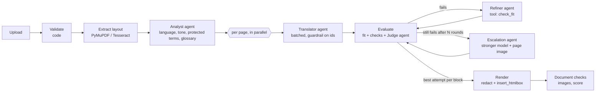

# Stark Document Translator

Upload a PDF, pick a language, get the same PDF back, translated, with its layout, fonts (when possible)
and images in place. Built with FastAPI, the OpenAI Agents SDK and PyMuPDF, branded for Stark Future.

```bash
cp .env.example .env          # put your OPENAI_API_KEY in it
docker compose up --build     # http://localhost:8000
```

No key? It still runs: without `OPENAI_API_KEY` the app switches to **demo mode**, where the same agents
run against a local pseudo-translation model (zero tokens, see [Pseudo mode](#pseudo-mode)).

## What it does

1. **Validates** the upload by content, not by name (magic bytes, size, page count, password, damaged file).
2. **Reads the layout**: every paragraph, heading, label and table cell becomes a *text unit* with its box,
   font, size, colour, weight, alignment, line height and enclosing frame. Scanned pages go through OCR.
3. **Analyses** the document once (Analyst agent): source language, tone, domain, a summary for the
   translators, **protected terms** (brands, product names, codes: *Stark* is a brand, not "strong") and a
   **jargon glossary** (holeshot, whoops, berm...).
4. **Translates** page by page, in parallel (Translator agent), with the analysis as shared context.
5. **Reviews** every block: does it fit its box (geometric check), deterministic checks (protected terms,
   numbers, script, markup, length) and an LLM **judge** using an MQM rubric (GEMBA-MQM style).
6. **Fixes** what failed (Refiner agent, which calls a `check_fit` tool to verify its text fits), at most
   N rounds; blocks that still do not converge are **escalated** to a stronger model that also sees the
   page image. The best attempt of each block wins.
7. **Rebuilds** the PDF: original text removed without touching images or vector graphics, translated
   text written into the same boxes, then checks that every image is still where it was.
8. Shows a **quality score**, the decisions taken, every issue found, a side-by-side preview, tokens per
   agent and a live agent trace.

## Testing guide (for reviewers)

`docker compose up --build`, open http://localhost:8000. The header says **Live** (key found) or
**Demo mode**. Every sample below is one click away under "Or try a sample".

| Try | What to look at |
|---|---|
| `08-jargon-en` → Spanish or German | **Decisions** tab: Stark, Stark VARG, Stark Future are protected; holeshot/whoops/berm in the glossary. The translation keeps "Stark VARG". |
| `02-tight-boxes-en` → German | Short labels in fixed boxes (table cells, buttons, callouts) grow 30 to 300% in German. **Side by side**: nothing spills out of its box. **Blocks & issues**: blocks that were shrunk or shortened by the Refiner. |
| `02-tight-boxes-en` / `03-multi-style-en` → Arabic | Right-to-left, shaped Arabic text, right-aligned in the original boxes. |
| `03-multi-style-en` → Chinese | CJK font embedded automatically; bold/italic inline words preserved. |
| `05-source-ar` / `06-source-zh` → English | Non-Latin sources: Arabic text layers come out of PDFs scrambled (lam-alef ligatures, numbers out of place); the prompt tells the translator to translate meaning, not artifacts. Chinese expands a lot into English. |
| `07-scanned-en` → Spanish | Page without a text layer: detected as a scan, OCR'd (Tesseract), text painted over with the sampled paper colour. |
| `09-stark-varg-manual-20p` → any | First 20 pages of the real Stark VARG owner's manual: subset fonts, TOC with tab leaders, photos, warning panels. |
| Upload `samples/invalid/*.pdf` | `not-a-pdf.pdf`, `encrypted.pdf` are rejected with a clear message; `truncated.pdf` is repaired and translated with a warning that content may be missing. |
| Reload the page during a job | The job resumes (URL keeps `#job=<id>`, events are replayed over SSE). |

During a job: the step bar, a tile per page (coloured by its score when done) and **Agent activity**
(stages, analyst findings, refine/escalation rounds, tool calls, guardrail trips, agent spans with
timings). After it: **Download**, **Side by side**, **Decisions**, **Blocks & issues** (score, issues by
origin `check`/`judge`, attempt history like `translate 75 → refine 100`), **Cost & trace**.

## Architecture



**Code orchestrates, agents judge.** The order of the steps is known in advance, so an LLM router would only
add latency, cost and non-determinism. Agents are used exactly where judgement is needed: understanding
the document, translating, reviewing, revising. Everything that can be measured is measured in code.

| Agent | Model (default) | Output | Why this model |
|---|---|---|---|
| Analyst | `gpt-5.4-mini` | `DocumentAnalysis` | one call per document, sees a round-robin sample of all pages |
| Translator | `gpt-5.4-mini` | `TranslationBatch` | the bulk of the tokens: cheap and fast, reasoning `none` |
| Judge (MQM) | `gpt-5.4` | `JudgeReport` | a different, stronger model than the translator (models grade themselves too kindly) |
| Refiner | `gpt-5.4-mini` + `check_fit` tool | `TranslationBatch` | targeted fixes with concrete issues, verifies fit itself |
| Escalation | `gpt-5.5` + `check_fit` + page image | `TranslationBatch` | only for blocks that did not converge |

All models are env vars (`.env.example`). Cheap while building, expensive only where quality is decided.

### Agents SDK features used

- **Structured outputs** (`output_type`, Pydantic, strict JSON schema) for every agent.
- **Dynamic instructions**: prompts are functions of a typed run context (`TranslationContext`) holding the
  target language and the analysis, so every translator, the judge and the refiner share the same glossary.
- **Tool calling**: `check_fit(block_id, text)` lets the Refiner ask the layout engine whether a candidate
  fits *before* answering. It closes the loop between language and geometry.
- **Output guardrail** `one_translation_per_block`: trips when the model skips, invents, duplicates or
  empties block ids; the runner retries with the exact list of expected ids.
- **Retries**: transport errors (429/5xx/timeouts, `Retry-After`) via `ModelRetrySettings` with exponential
  backoff; model errors (invalid JSON, guardrail trips, max turns) retried at app level; a failing batch is
  split in halves down to single blocks, and a block that still fails keeps its source text and is reported
  as a critical issue instead of sinking the job.
- **Tracing**: one trace per job (`trace(..., group_id=job_id)`), exported to the OpenAI dashboard, and a
  local `TracingProcessor` that streams every span (agent, model response, tool, guardrail) to the UI.
- **Custom `Model`**: `app/ai/pseudo.py` implements the SDK `Model` interface; see below.

### Handling the hard parts

**Text expansion / overflow.** German grows ~30% on paragraphs and 200-300% on short labels (IBM/W3C data);
Chinese into English grows too. Per block, in order: (1) original box, (2) grow into free space below/right
(never into another block, an image, or out of its frame such as a table cell or a button), (3) shrink the
font down to 72%, (4) still overflowing: the quality loop asks the Refiner for a shorter version with a
character budget and the `check_fit` tool, (5) last resort: force-fit and report it as a layout issue.
Fit is measured geometrically with MuPDF's HTML engine (`Story.place`), including words wider than the box.

**Same typography.** Original embedded fonts are reused when they really contain every glyph the
translation needs. Subset fonts lie (their cmap lists accented letters whose outlines were stripped, and
MuPDF forces `fi`/`fl` ligatures that subsets often lack), so coverage is checked by rendering glyphs and
looking for ink. Otherwise the closest generic family (sans, serif, mono) with the original weight, style,
size, colour, alignment and line height is used. Scripts the font cannot cover (CJK, Arabic) use MuPDF's
built-in Noto/Droid fonts with HarfBuzz shaping and bidi.

**Images and graphics** stay byte-identical: original text is removed with redactions that leave images and
vector art alone, and a post-render check compares every image's position.

**Large documents / context window.** One translation call per page (or per 6 000 characters), so no call
gets near the context window; the document-level summary and glossary give every call the global context.
Pages run concurrently (`MAX_CONCURRENT_PAGES`) under a global semaphore for LLM calls.

**Speed.** Pages in parallel, batched blocks, judge only re-run on revised blocks, cheap model with
reasoning `none` for the bulk. 1-page samples take ~15 s live; 20 pages of the manual run in parallel.

**New format in 10 minutes.** The pipeline only sees `TextUnit`s and `Fit`s through the
`FormatHandler`/`LoadedDocument` protocols in `app/formats/base.py`. A DOCX or Markdown handler implements
`units`, `measure` (always "fit" for flowing formats) and `render`, and registers in `app/formats/__init__.py`.
Agents, checks and the loop are untouched.

**Unsupported or corrupted files.** Detected by content, rejected before queueing with a message the user can
act on (not a PDF, password protected, too many pages, unreadable). Repairable damage is repaired, with a
warning. Unexpected errors are logged with a stack trace and shown as a generic message.

**Security.** Content sniffing, size limit enforced while reading, page limit, sanitized file names, random
job ids validated by regex (no path traversal), samples resolved by base name, extracted PDF text escaped
before it is used as HTML (only balanced `<b>`/`<i>` survive), CSP and other security headers, non-root
container, jobs and files expire after `JOB_TTL_HOURS`. The API key only lives in env vars.

## How quality is measured

Three layers, cheapest first:

1. **Deterministic** (free, instant, never hallucinates): fit/overflow, protected terms present, numbers
   preserved (locale separators tolerated), output in the target script, not identical to the source,
   `<b>`/`<i>` preserved, length ratio sanity, images unmoved.
2. **LLM judge** (GEMBA-MQM style): errors with severity (minor/major/critical) and category. A block's score
   is `100 - 25·critical - 10·major - 2·minor` over check and judge issues; the document score is the
   length-weighted mean. Threshold `QUALITY_THRESHOLD=85`.
3. **Visual**: side-by-side page renders in the UI and in eval reports.

The same evaluator runs **online** (every job, shown to the user) and **offline** (`evals/run.py` over the
corpus, where you can afford a more expensive judge with `--judge-model`).

## Pseudo mode

`LLM_BACKEND=pseudo` (or no key) plugs `PseudoModel` into the same agents. Translations are
pseudo-localizations (the i18n technique used by Netflix and Microsoft): longer by the target language's
typical expansion, written in the target script (accents, Arabic letters, CJK), respecting tags, numbers and
protected terms. It injects a mistake in about 1 block in 9 (a dropped number, a translated brand) so the
review loop has real work. The Refiner really calls `check_fit` through the SDK. Result: the whole system,
including layout stress tests in Arabic and Chinese, runs in CI and in development for free.

## Samples

`samples/` (all ≤ 5 pages, except the manual excerpt), described in `samples/manifest.json`, regenerated by
`python samples/generate.py --manual <full manual.pdf>`:

| File | Stresses |
|---|---|
| `01-simple-en` | happy path |
| `02-tight-boxes-en` | short labels in fixed boxes, table cells, buttons, callouts: overflow |
| `03-multi-style-en` | 2 columns, serif/sans/mono, inline bold/italic, coloured frame, caption |
| `04-source-de` | German source: umlauts, ß, compounds |
| `05-source-ar` | Arabic source with a realistic (imperfect) text layer |
| `06-source-zh` | Chinese source |
| `07-scanned-en` | no text layer: OCR |
| `08-jargon-en` | brand names vs dictionary words, motocross slang |
| `09-stark-varg-manual-20p` | first 20 pages of the real Stark VARG owner's manual |
| `invalid/` | truncated, encrypted, not a PDF |

Target languages were chosen to fail differently: German (expansion, umlauts), Arabic (RTL, shaping),
Chinese (logographic, no spaces, contraction, CJK fonts), Spanish (lets a Spanish speaker check the judge).

## Development

```bash
python3 -m venv .venv && .venv/bin/pip install -r requirements-dev.txt   # + apt install tesseract-ocr
.venv/bin/uvicorn app.main:app --reload            # uses .env
.venv/bin/python -m pytest                         # 30+ tests, no network (pseudo model)
.venv/bin/python -m evals.run                      # whole corpus, pseudo, zero tokens
.venv/bin/python -m evals.run --backend openai --samples 02 08 --targets de es
```

Eval runs write `evals/results/<timestamp>/summary.md` plus the translated PDFs and side-by-side PNGs.

## Deploy on Coolify

The repo ships `docker-compose.coolify.yml` (no published ports, Coolify's proxy routes to port 8000,
health check on `/api/health`, persistent `/data` volume).

1. Coolify → Project → **+ New** → Public repository (or GitHub App) → `https://github.com/jperelli/pdf-translator`, branch `main`.
2. Build pack **Docker Compose**, Docker Compose Location `/docker-compose.coolify.yml`.
3. **Environment Variables**: set `OPENAI_API_KEY` (required, marked by `${OPENAI_API_KEY:?}`); the model and
   limit variables appear with their defaults.
4. **Domains**: keep the generated one or set yours on service `app` (port 8000), then **Deploy**.

Alternatively use the plain **Dockerfile** build pack: port 8000, health check path `/api/health`,
`OPENAI_API_KEY` as a runtime variable, and a volume on `/data`.

## Configuration

See `.env.example`. The main knobs: models per agent, `REASONING_EFFORT`, `QUALITY_THRESHOLD`,
`MAX_REFINE_ITERATIONS`, `ENABLE_JUDGE`, `ENABLE_ESCALATION`, `MAX_CONCURRENT_PAGES`, `MIN_FONT_SCALE`,
`MAX_UPLOAD_MB`, `MAX_PAGES`, `OCR_LANGUAGE`, `OPENAI_TRACING`.

## Project layout

```
app/
  main.py               FastAPI: upload, jobs, SSE events, download, page previews, static UI
  jobs.py               background jobs, event fan-out, TTL cleanup
  pipeline.py           orchestration + evaluator-optimizer loop + report
  ai/agents.py          agent definitions, guardrail, check_fit tool, resilient runner
  ai/prompts.py         runtime prompts (also in PROMPTS.md)
  ai/schemas.py         structured outputs
  ai/pseudo.py          local Model implementation (pseudo-localization)
  ai/setup.py           API key + tracing wiring
  observability.py      TracingProcessor streaming spans to the job
  formats/base.py       FormatHandler / LoadedDocument protocols
  formats/pdf/          extract.py (layout, OCR), render.py (fonts, fit ladder, redaction), __init__.py
  quality/checks.py     deterministic checks and MQM-style scoring
  static/               UI (no build step)
evals/run.py            offline eval harness
samples/                test corpus + generator
tests/                  pytest
```

## Known limitations

- Rotated and vertical text is left untouched.
- PDFs written by MuPDF itself in Arabic have a lossy text layer (copy/paste of the *output* is imperfect,
  the visual is correct).
- Inline styling inside a paragraph is limited to bold/italic; mixed colours or sizes inside one paragraph
  take the dominant style.
- Original fonts are rarely reusable for accented targets because commercial PDFs embed subsets.
- Jobs live in one process (in-memory registry + files on `/data`); horizontal scaling needs a queue.
- The interactive glossary approval (choose which jargon to translate before translating) is the next step;
  today the decisions are shown after the fact.
