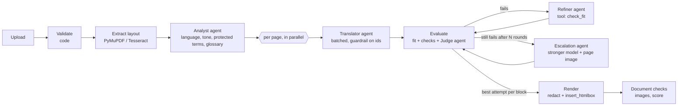
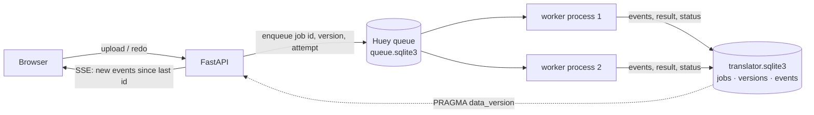

# Stark Document Translator

Upload a PDF, pick a language, get the same PDF back, translated, with its layout, fonts (when possible)
and images in place. Built with FastAPI, the OpenAI Agents SDK and PyMuPDF, branded for Stark Future.

```bash
cp .env.example .env          # put your OPENAI_API_KEY in it
docker compose up --build     # http://localhost:8000
```

No key? It still runs: without `OPENAI_API_KEY` the app switches to **demo mode**, where the same agents
run against a local pseudo-translation model (zero tokens, see [Pseudo mode](#pseudo-mode)).

## What it does

1. **Validates** the upload by content, not by name (magic bytes, size, page count, password, damaged file).
2. **Reads the layout**: every paragraph, heading, label and table cell becomes a *text unit* with its box,
   font, size, colour, weight, alignment, line height and enclosing frame. Scanned pages go through OCR.
3. **Analyses** the document once (Analyst agent): source language, tone, domain, a summary for the
   translators, **protected terms** (brands, product names, codes: *Stark* is a brand, not "strong") and a
   **jargon glossary** (holeshot, whoops, berm...).
4. **Translates** page by page, in parallel (Translator agent), with the analysis as shared context.
5. **Reviews** every block: does it fit its box (geometric check), deterministic checks (protected terms,
   numbers, script, markup, length) and an LLM **judge** using an MQM rubric (GEMBA-MQM style).
6. **Fixes** what failed (Refiner agent, which calls a `check_fit` tool to verify its text fits), at most
   N rounds; blocks that still do not converge are **escalated** to a stronger model that also sees the
   page image. The best attempt of each block wins.
7. **Lays out every page** in reading order: each block claims the space its text really uses, so two
   blocks never grow into the same area; separators, underlines, images and frames are obstacles. Collisions
   found here go back into the loop like any other failure.
8. **Rebuilds** the PDF (original text removed without touching images or vector graphics; underlines move
   with their text) and **reads the result back**: overlapping lines, the fonts MuPDF really used, images
   in place.
9. Shows **two scores**, translation quality and layout fidelity, with the lower one as the headline; a
   single overlap fails the document. A **Review** tab lists what did not work with alternatives, and
   **Apply and redo** creates a new version reprocessing only the affected blocks.
10. Keeps every run and version in SQLite: a **History** screen, per-version downloads, and **Stats** with the
    tokens and estimated cost of evaluation, back and forth, each page, the whole document and the glyph builder.

## Testing guide (for reviewers)

`docker compose up --build`, open http://localhost:8000. The header says **Live** (key found) or
**Demo mode**. Every sample below is one click away under "Or try a sample".

| Try | What to look at |
|---|---|
| `08-jargon-en` → Spanish or German | **Details → Jargon**: Stark, Stark VARG, Stark Future are protected; holeshot/whoops/berm in the glossary. The translation keeps "Stark VARG". |
| `02-tight-boxes-en` → German | Short labels in fixed boxes (table cells, buttons, callouts) grow 30 to 300% in German. **Preview**: nothing spills out of its box. **Details → Refinement**: blocks that were shrunk or shortened by the Refiner. |
| `02-tight-boxes-en` / `03-multi-style-en` → Arabic | Right-to-left, shaped Arabic text, right-aligned in the original boxes. |
| `03-multi-style-en` → Chinese | CJK font embedded automatically; bold/italic inline words preserved. |
| `05-source-ar` / `06-source-zh` → English | Non-Latin sources: Arabic text layers come out of PDFs scrambled (lam-alef ligatures, numbers out of place); the prompt tells the translator to translate meaning, not artifacts. Chinese expands a lot into English. |
| `07-scanned-en` → Spanish | Page without a text layer: detected as a scan, OCR'd (Tesseract), text painted over with the sampled paper colour. |
| `09-stark-varg-manual-20p` → any | First 20 pages of the real Stark VARG owner's manual: subset fonts, TOC with tab leaders, photos, warning panels. |
| `09-stark-varg-manual-20p` → German, then **Review** | The heading font (a 40-glyph subset) has no Ä/Ö/Ü: they are **built from the font's own pieces** (A + two of its periods), 0 tokens. Into Spanish it has no acute or tilde to borrow, so Review proposes **similar fonts** (ranked by metrics, with previews: Michroma for StarkSans), rewriting with available characters, or keeping the fallback. Pick one, **Apply and redo**: v2 appears, the version switcher and **Stats** show it cost 0 tokens. |
| `10-cv-like-en` → German | A CV whose words are stored without spaces, a two-column header, underlined links, separators and symbol-font arrows: the regression test for overlapping text. **Preview** → "Outline blocks with issues". |
| `11-subset-heading-en` → German | Headings in a subset font without umlauts: no mixed-font "ANHÄNGE" any more. |
| **Fast** (default) vs **Quality** on the upload screen | Fast: cheap, the translator model also reviews, no escalation, fonts may fall back, no thorough style check. Quality: stronger reviewer, escalation, minimal font shrinking, every layout mismatch listed and fixed. Overlaps are blocked in both. |
| **History** in the header | Every run with its scores, versions, tokens and cost; open, download, pin, delete. Survives restarts. |
| Upload `samples/invalid/*.pdf` | `not-a-pdf.pdf`, `encrypted.pdf` are rejected with a clear message; `truncated.pdf` is repaired and translated with a warning that content may be missing. |
| Reload the page during a job | The job resumes (URL keeps `#job=<id>`, events are replayed over SSE). |

During a job: the step bar, a tile per page (coloured by its score when done) and **Agent activity**
(stages, analyst findings, layout collisions sent back, refine/escalation rounds, tool calls, guardrail
trips, agent spans with timings).

After it, the top bar has the headline score (with translation and layout sub-scores and the reasons when
it fails), **Download** and the version switcher, then three tabs:

- **Preview**: side by side, optionally outlining the blocks with issues (click one to open it).
- **Details**: **Jargon** (language, tone, protected terms, glossary), **Refinement** (every block with its
  two scores, issues by origin `check`/`judge`, attempt history like `translate 75 → refine 100`), **Stats**
  (tokens and estimated cost by stage and per page, agents and models, work without tokens such as the
  glyph builder and layout QA, timeline, all versions) and **Log** (the progress log, filterable).
- **Review**: collisions, missing characters per font, low-quality blocks, heavy shrinking and terms, each
  with options marked "uses tokens" / "no tokens", an estimate before running, and **Apply and redo**.

## Architecture



**Code orchestrates, agents judge.** The order of the steps is known in advance, so an LLM router would only
add latency, cost and non-determinism. Agents are used exactly where judgement is needed: understanding
the document, translating, reviewing, revising. Everything that can be measured is measured in code.

| Agent | Model (default) | Output | Why this model |
|---|---|---|---|
| Analyst | `gpt-5.4-mini` | `DocumentAnalysis` | one call per document, sees a round-robin sample of all pages |
| Translator | `gpt-5.4-mini` | `TranslationBatch` | the bulk of the tokens: cheap and fast, reasoning `none` |
| Judge (MQM) | `gpt-5.4` | `JudgeReport` | a different, stronger model than the translator (models grade themselves too kindly) |
| Refiner | `gpt-5.4-mini` + `check_fit` tool | `TranslationBatch` | targeted fixes with concrete issues, verifies fit itself |
| Escalation | `gpt-5.5` + `check_fit` + page image | `TranslationBatch` | only for blocks that did not converge |

All models are env vars (`.env.example`). Cheap while building, expensive only where quality is decided.

### Jobs: a Huey queue on SQLite

Each translation, and each redo from the Review tab, is a task in a **Huey** queue stored in SQLite
(`/data/queue.sqlite3`). Workers are separate processes, so the web server never runs PDF or LLM work.



- **Progress lives in our `events` table, not in Huey.** The pipeline writes every event (stage, page, refine,
  agent span...) as a row. The SSE endpoint keeps a cursor and only queries when `PRAGMA data_version` says
  another connection committed, so near-real-time progress costs almost nothing. The same rows are the
  Log tab and the history: there is no separate "save the log" step.
- **A task is a plain function** (Huey is synchronous) that runs the async pipeline with `asyncio.run()`.
  Inside the job everything stays concurrent: pages in parallel, overlapping LLM calls. Each task creates its
  own OpenAI client, because an async client belongs to the event loop that created it.
- **Lost workers.** A job remembers which worker process runs it (host, pid and the process start time from
  `/proc`). A periodic task requeues jobs whose worker no longer exists (crash, OOM, redeploy) as a new attempt,
  once; a second loss fails the job. Each attempt has its own events and a stale attempt cannot overwrite a
  newer one. A heartbeat thread exists as a fallback for workers on another host.
  - Why not just the heartbeat: a single MuPDF call can hold the GIL for most of a minute (measured: 47 s when
    rendering the Chinese manual), so a live worker's heartbeat thread stalls and it looks dead.
- `scripts/start.sh` runs `huey_consumer` (`WORKERS` processes, default 2) and uvicorn in one container. If either
  exits, the container exits and Docker's restart policy brings both back; interrupted jobs are then retried.

### Agents SDK features used

- **Structured outputs** (`output_type`, Pydantic, strict JSON schema) for every agent.
- **Dynamic instructions**: prompts are functions of a typed run context (`TranslationContext`) holding the
  target language and the analysis, so every translator, the judge and the refiner share the same glossary.
- **Tool calling**: `check_fit(block_id, text)` lets the Refiner ask the layout engine whether a candidate
  fits *before* answering. It closes the loop between language and geometry.
- **Output guardrail** `one_translation_per_block`: trips when the model skips, invents, duplicates or
  empties block ids; the runner retries with the exact list of expected ids.
- **Retries**: transport errors (429/5xx/timeouts, `Retry-After`) via `ModelRetrySettings` with exponential
  backoff; model errors (invalid JSON, guardrail trips, max turns) retried at app level; a failing batch is
  split in halves down to single blocks, and a block that still fails keeps its source text and is reported
  as a critical issue instead of sinking the job.
- **Tracing**: one trace per job (`trace(..., group_id=job_id)`), exported to the OpenAI dashboard, and a
  local `TracingProcessor` that streams every span (agent, model response, tool, guardrail) to the UI.
- **Custom `Model`**: `app/ai/pseudo.py` implements the SDK `Model` interface; see below.

### Handling the hard parts

**Text expansion / overflow.** German grows ~30% on paragraphs and 200-300% on short labels (IBM/W3C data);
Chinese into English grows too. Per block, in order: (1) original box, (2) grow into free space below/right
(never into another block, an image, or out of its frame such as a table cell or a button), (3) shrink the
font down to 72%, (4) still overflowing: the quality loop asks the Refiner for a shorter version with a
character budget and the `check_fit` tool, (5) last resort: force-fit and report it as a layout issue.
Fit is measured geometrically with MuPDF's HTML engine (`Story.place`), including words wider than the box.

**Same typography.** Original embedded fonts are reused when they really contain every glyph the
translation needs. Subset fonts lie (their cmap lists accented letters whose outlines were stripped, and
MuPDF forces `fi`/`fl` ligatures that subsets often lack), so coverage is checked by rendering glyphs and
looking for ink. Otherwise the closest generic family (sans, serif, mono) with the original weight, style,
size, colour, alignment and line height is used. Scripts the font cannot cover (CJK, Arabic) use MuPDF's
built-in Noto/Droid fonts with HarfBuzz shaping and bidi.

**Images and graphics** stay byte-identical: original text is removed with redactions that leave images and
vector art alone, and a post-render check compares every image's position.

**Large documents / context window.** One translation call per page (or per 6 000 characters), so no call
gets near the context window; the document-level summary and glossary give every call the global context.
Pages run concurrently (`MAX_CONCURRENT_PAGES`) under a global semaphore for LLM calls.

**Speed.** Pages in parallel, batched blocks, judge only re-run on revised blocks, cheap model with
reasoning `none` for the bulk. 1-page samples take ~15 s live; 20 pages of the manual run in parallel.

**New format in 10 minutes.** The pipeline only sees `TextUnit`s and `Fit`s through the
`FormatHandler`/`LoadedDocument` protocols in `app/formats/base.py`. A DOCX or Markdown handler implements
`units`, `measure` (always "fit" for flowing formats) and `render`, and registers in `app/formats/__init__.py`.
Agents, checks and the loop are untouched.

**Unsupported or corrupted files.** Detected by content, rejected before queueing with a message the user can
act on (not a PDF, password protected, too many pages, unreadable). Repairable damage is repaired, with a
warning. Unexpected errors are logged with a stack trace and shown as a generic message.

**Security.** Content sniffing, size limit enforced while reading, page limit, sanitized file names, random
job ids validated by regex (no path traversal), samples resolved by base name, extracted PDF text escaped
before it is used as HTML (only balanced `<b>`/`<i>` survive), CSP and other security headers, non-root
container, jobs and files expire after `JOB_TTL_HOURS`. The API key only lives in env vars.

## How quality is measured

Two scores, both 0-100, and the headline is the **lower** one:

- **Translation quality**: deterministic text checks + the LLM judge, as below.
- **Layout fidelity**: collisions (critical, and each one also costs 5 points at document level), text
  read back from the output PDF overlapping other text, fonts mixed inside a block, blocks that had to fall
  back to a generic font, heavy shrinking, images moved.
- **Passed** requires both scores ≥ `QUALITY_THRESHOLD`, **zero overlaps** and no untranslated block.

Layout is checked twice: on MuPDF's real line boxes for every block during the loop (so collisions are fixed
by the Refiner), and on the written PDF itself, which is the ground truth.

The text layers, cheapest first:

1. **Deterministic** (free, instant, never hallucinates): fit/overflow, protected terms present, numbers
   preserved (locale separators tolerated), output in the target script, not identical to the source,
   `<b>`/`<i>` preserved, length ratio sanity, images unmoved.
2. **LLM judge** (GEMBA-MQM style): errors with severity (minor/major/critical) and category. A block's score
   is `100 - 25·critical - 10·major - 2·minor` over check and judge issues; the document score is the
   length-weighted mean. Threshold `QUALITY_THRESHOLD=85`.
3. **Visual**: side-by-side page renders in the UI and in eval reports.

The same evaluator runs **online** (every job, shown to the user) and **offline** (`evals/run.py` over the
corpus, where you can afford a more expensive judge with `--judge-model`).

## Missing characters in original fonts

Embedded fonts are usually subsets: they list letters whose outlines were stripped, keep ligature rules
pointing at empty glyphs, and miss the target language's accents. `app/formats/pdf/glyphs.py` rebuilds
every embedded font with fontTools:

1. exact coverage: only glyphs with real outlines count (the old "render and look for ink" test was fooled
   by MuPDF's fallback, which is how "ANHÄNGE" ended up with a serif Ä);
2. missing accented letters are **built from the font's own pieces** (base letter + mark; a dieresis can be
   made from two of its periods). Pure code: **0 tokens**, a few milliseconds per font, reported in Stats;
3. the rebuilt font has no ligature table, so `fi` can no longer map to an empty glyph.

Before giving up on the original design:

- **Browser subsets.** Fonts embedded by Chrome/Skia "Save as PDF" have no Unicode cmap at all (codes 1..n);
  the letters are only in the PDF's `ToUnicode` map, which is used to rebuild the font's character map.
  Without it the font looked empty and every block fell back to a generic font.
- **Same family, complete font.** If the subset still lacks letters of the target language, the complete
  font of the same family and weight replaces it (`Ubuntu-Regular` → Ubuntu 400): from `app/fonts` if bundled,
  else from Google Fonts at runtime, cached in `/data/fonts` (`FONT_DOWNLOADS=false` to disable). Same design,
  every letter; Stats shows where it came from.
- **Serif or sans is measured, not trusted.** When a generic fallback is still needed, it is chosen from the
  font's own outlines (the foot of "I" is wider than its middle in a serif font). PDF flags are unreliable:
  browser subsets are flagged "symbolic", which MuPDF reports as serif.

When a letter cannot be built, the block uses a generic font as a whole (never a mixed word) and Review
offers: a **similar complete font** for the whole document (ranked by width, cap height, x-height and
stroke density from the bundled OFL fonts in `app/fonts`, and from Google Fonts at runtime only when none
of them is close enough), **rewriting** with the characters the font has (Refiner with the allowed
character set), **transliterating** (only for German umlauts/ß: ñ → n would change meaning), or keeping
the fallback.

## Pseudo mode

`LLM_BACKEND=pseudo` (or no key) plugs `PseudoModel` into the same agents. Translations are
pseudo-localizations (the i18n technique used by Netflix and Microsoft): longer by the target language's
typical expansion, written in the target script (accents, Arabic letters, CJK), respecting tags, numbers and
protected terms. It injects a mistake in about 1 block in 9 (a dropped number, a translated brand) so the
review loop has real work. The Refiner really calls `check_fit` through the SDK. Result: the whole system,
including layout stress tests in Arabic and Chinese, runs in CI and in development for free.

## Samples

`samples/` (all ≤ 5 pages, except the manual excerpt), described in `samples/manifest.json`, regenerated by
`python samples/generate.py --manual <full manual.pdf>`:

| File | Stresses |
|---|---|
| `01-simple-en` | happy path |
| `02-tight-boxes-en` | short labels in fixed boxes, table cells, buttons, callouts: overflow |
| `03-multi-style-en` | 2 columns, serif/sans/mono, inline bold/italic, coloured frame, caption |
| `04-source-de` | German source: umlauts, ß, compounds |
| `05-source-ar` | Arabic source with a realistic (imperfect) text layer |
| `06-source-zh` | Chinese source |
| `07-scanned-en` | no text layer: OCR |
| `08-jargon-en` | brand names vs dictionary words, motocross slang |
| `09-stark-varg-manual-20p` | first 20 pages of the real Stark VARG owner's manual |
| `10-cv-like-en` | CV layout: words without space characters, two-column header, underlines, separators, symbol-font arrows |
| `11-subset-heading-en` | headings in a font subset without umlauts or accents |
| `12-subset-unicode-en` | browser-style TrueType subsets: letters only in `ToUnicode`, flagged symbolic, a sans font whose name has no "sans" |
| `invalid/` | truncated, encrypted, not a PDF |

Target languages were chosen to fail differently: German (expansion, umlauts), Arabic (RTL, shaping),
Chinese (logographic, no spaces, contraction, CJK fonts), Spanish (lets a Spanish speaker check the judge).

## Development

```bash
python3 -m venv .venv && .venv/bin/pip install -r requirements-dev.txt   # + apt install tesseract-ocr
scripts/start.sh                                   # web + queue workers, uses .env (or run the two below)
.venv/bin/uvicorn app.main:app --reload            # web only...
.venv/bin/huey_consumer app.worker.huey -k process -w 2   # ...plus the workers
QUEUE_IMMEDIATE=1 .venv/bin/uvicorn app.main:app   # single process: each job runs inside its request
.venv/bin/python -m pytest                         # 50+ tests, no network (pseudo model, immediate queue)
.venv/bin/python -m evals.run                      # whole corpus, pseudo, zero tokens
.venv/bin/python -m evals.run --backend openai --samples 02 08 --targets de es
```

Eval runs write `evals/results/<timestamp>/summary.md` plus the translated PDFs and side-by-side PNGs.

## Deploy on Coolify

The repo ships `docker-compose.coolify.yml` (no published ports, Coolify's proxy routes to port 8000,
health check on `/api/health`, persistent `/data` volume). **Keep `/data` on a persistent volume**: it holds
the SQLite database (history, versions) and the job files.

1. Coolify → Project → **+ New** → Public repository (or GitHub App) → `https://github.com/jperelli/pdf-translator`, branch `main`.
2. Build pack **Docker Compose**, Docker Compose Location `/docker-compose.coolify.yml`.
3. **Environment Variables**: set `OPENAI_API_KEY` (required, marked by `${OPENAI_API_KEY:?}`); the model and
   limit variables appear with their defaults.
4. **Domains**: keep the generated one or set yours on service `app` (port 8000), then **Deploy**.

Alternatively use the plain **Dockerfile** build pack: port 8000, health check path `/api/health`,
`OPENAI_API_KEY` as a runtime variable, and a persistent storage mounted on `/data` (this is how the demo
instance is deployed).

## Configuration

See `.env.example`. The main knobs: models per agent, `REASONING_EFFORT`, `QUALITY_THRESHOLD`,
`MAX_REFINE_ITERATIONS`, `ENABLE_JUDGE`, `ENABLE_ESCALATION`, `MAX_CONCURRENT_PAGES`, `MIN_FONT_SCALE`,
`MAX_UPLOAD_MB`, `MAX_PAGES`, `OCR_LANGUAGE`, `OPENAI_TRACING`. Queue: `WORKERS` (translations at the same
time), `WORKER_MAX_TASKS` (recycle a worker process after N jobs), `QUEUE_IMMEDIATE`, `STALE_AFTER_S`,
`MAX_ATTEMPTS`.

## Project layout

```
app/
  main.py               FastAPI: upload, jobs, SSE events, download, page previews, static UI
  jobs.py               web side of the jobs: enqueue, read status/results, stream events, TTL cleanup
  worker.py             Huey tasks: run a job, lost-worker recovery
  store.py              SQLite persistence (jobs, versions, events, decisions)
  pipeline.py           orchestration + evaluator-optimizer loop + layout rounds + redo + report
  review.py             review items, decisions, transliteration, token estimate
  ai/agents.py          agent definitions, guardrail, check_fit tool, resilient runner
  ai/prompts.py         runtime prompts (also in PROMPTS.md)
  ai/schemas.py         structured outputs
  ai/pseudo.py          local Model implementation (pseudo-localization)
  ai/setup.py           API key + tracing wiring
  observability.py      TracingProcessor streaming spans to the job
  formats/base.py       FormatHandler / LoadedDocument protocols
  formats/pdf/          extract.py (layout, OCR), render.py (fit ladder, space claims, probes, redaction),
                        glyphs.py (font rebuilding, accent building), fontmatch.py (similar fonts)
  fonts/                bundled OFL candidate fonts (scripts/fetch_fonts.py)
  quality/checks.py     deterministic text checks and MQM-style scoring
  quality/layout.py     collisions, font fallbacks, read-back of the written PDF
  static/               UI (no build step)
scripts/start.sh        container entry point: queue workers + web
evals/run.py            offline eval harness
samples/                test corpus + generator
tests/                  pytest
```

## Known limitations

- Rotated and vertical text is left untouched.
- PDFs written by MuPDF itself in Arabic have a lossy text layer (copy/paste of the *output* is imperfect,
  the visual is correct).
- Inline styling inside a paragraph is limited to bold/italic; mixed colours or sizes inside one paragraph
  take the dominant style.
- Accents are built only when the font has the base letter and a mark (or a period for a dieresis); CID
  subsets without a Unicode map cannot be reused at all and fall back to the closest generic family.
- Token usage of agent calls that fail and are retried is not counted in Stats (the provider still bills it).
- The queue, database and files share one `/data` volume: workers scale up on one host (`WORKERS`), not across
  hosts. That would need a network database and shared storage (Huey also supports Redis and Postgres).
- A retried job starts over from page 1 and pays its tokens again (no per-page checkpoints yet).
- Term decisions (keep jargon in the original language, translate a "protected" word) are taken in Review,
  after the first pass, not before translating.
